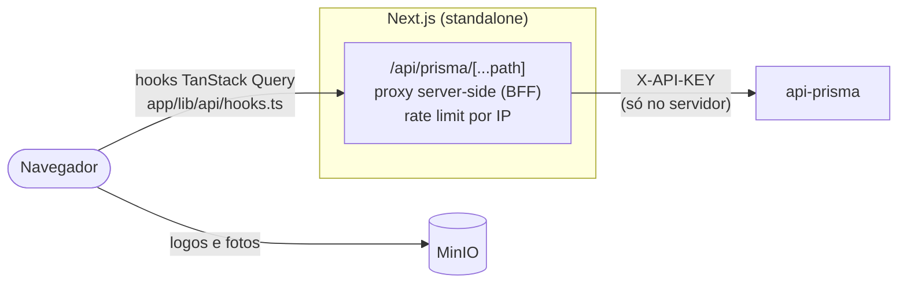

<div align="center">

# 🖥 app-prisma

**Interface web do PRISMA**: mostra ao eleitor o teor da cobertura da imprensa sobre partidos e candidatos (negativo, neutro e positivo), por tema e por veículo, sempre com link para a matéria de origem.


[Organização PRISMA](https://github.com/prisma-projetos) · [API](https://github.com/prisma-projetos/api-prisma)

</div>

---

## 📍 Onde este módulo fica no PRISMA

```
scrapping-prisma ──▶ classifier-prisma ──▶ analyser-prisma ──▶ System DB ──▶ api-prisma ──▶ [ app-prisma ] ──▶ eleitor
                                                                                               ▲ você está aqui
```

Este repositório é **apenas a camada de apresentação**. Classificação, agregação e geração dos panoramas acontecem no pipeline e são consumidas pela [`api-prisma`](https://github.com/prisma-projetos/api-prisma).

> O PRISMA mede o **teor do que foi publicado** sobre cada entidade, **não o viés da fonte**. Ele não classifica veículos nem pessoas no espectro ideológico.

## 📑 Sumário

- [Funcionalidades](#-funcionalidades)
- [Arquitetura](#-arquitetura)
- [Como rodar](#-como-rodar)
- [Variáveis de ambiente](#-variáveis-de-ambiente)
- [Scripts](#-scripts)
- [Estrutura](#-estrutura)
- [Regras de produto (obrigatórias)](#-regras-de-produto-obrigatórias)
- [Workflow: Spec-Driven Development](#-workflow-spec-driven-development)
- [Docker e CI/CD](#-docker-e-cicd)
- [Repositórios do PRISMA](#-repositórios-do-prisma)

## ✨ Funcionalidades

| Rota | O que mostra |
|---|---|
| `/` | Busca e lista de partidos |
| `/partidos/[nrPartido]` | Página do partido: sentimento, temas, veículos, panorama e candidatos |
| `/politicos/[tituloEleitoral]` | Página do político: candidaturas, resultado, sentimento, temas e panorama |
| `/candidatos` | Candidaturas da eleição, com busca por nome e filtros de cargo e partido |
| `/estados` | Mapa do Brasil. Ao clicar num estado, abre os candidatos da UF, divididos por cargo (`NEXT_PUBLIC_FILTRO_UF`) |

Também inclui um seletor de **janela** (mês), modo claro/escuro que segue o sistema, gráfico de temas, retícula nos sentimentos (sem depender de cor) e layout *mobile-first*.

## 🏗 Arquitetura



- **O navegador nunca chama a API diretamente.** Tudo passa pelo proxy em `app/api/prisma/[...path]/route.ts`, que injeta a `X-API-KEY`. A chave **nunca** usa o prefixo `NEXT_PUBLIC_`.
- **Rate limit por IP** no proxy, ativo apenas quando existe um proxy reverso confiável (`PROXIES_CONFIAVEIS`).
- **Cabeçalhos de segurança (CSP etc.)** calculados no build em `app/lib/seguranca.ts`, com a origem das imagens vinda de `IMAGENS_ORIGEM`.

## 🚀 Como rodar

**Pré-requisitos:** Node.js 20+ e pnpm 10 (`corepack enable`).

```bash
git clone git@github.com:prisma-projetos/app-prisma.git
cd app-prisma

pnpm install
cp .env.example .env.local      # preencha API_PRISMA e API_PRISMA_KEY
pnpm dev                        # http://localhost:3000
```

> Esta versão do Next.js tem mudanças incompatíveis com versões anteriores. Antes de alterar código, consulte `node_modules/next/dist/docs/` (veja [`AGENTS.md`](AGENTS.md)).

## ⚙ Variáveis de ambiente

| Variável | Quando é lida | Descrição |
|---|---|---|
| `API_PRISMA` | Runtime (servidor) | URL base da `api-prisma`, sem `/api` no final |
| `API_PRISMA_KEY` | Runtime (servidor) | Chave enviada em `X-API-KEY`. **Nunca exponha ao cliente** |
| `PROXIES_CONFIAVEIS` | Runtime | Número de proxies reversos que acrescentam o IP do visitante em `X-Forwarded-For`. Com valor `> 0`, ativa o rate limit de 60 req/min por IP |
| `IMAGENS_ORIGEM` | **Build** | Origem das imagens (MinIO) liberada na CSP |
| `NEXT_PUBLIC_FILTRO_UF` | **Build** | `1` ativa a aba "Estados" e o filtro por UF |
| `DEV_ORIGINS` | Dev | Origens extras permitidas no `next dev` (por exemplo, o celular na rede local) |

## 📜 Scripts

```bash
pnpm dev      # desenvolvimento
pnpm build    # build de produção (output: standalone)
pnpm start    # serve o build
pnpm lint     # ESLint
pnpm test     # Vitest + Testing Library (jsdom)
```

## 📂 Estrutura

```
├── app/
│   ├── page.tsx                      # home (busca + partidos)
│   ├── partidos/[nrPartido]/         # página do partido
│   ├── politicos/[tituloEleitoral]/  # página do político
│   ├── candidatos/ · estados/        # listas e mapa
│   ├── api/prisma/[...path]/         # proxy server-side para a api-prisma
│   ├── components/                   # UI (panorama, sentimento, temas, disclaimer, mapa…)
│   └── lib/
│       ├── api/                      # client, hooks, query keys, tipos, server/ (proxy + rate limit)
│       └── seguranca.ts · janela.ts · sentimento.ts · …
├── specs/                            # specs SDD (ativas) + done/ (implementadas)
├── test/                             # setup, fixtures (OpenAPI v1) e testes de regras de produto
├── docker/Dockerfile                 # multi-stage, Node 22 alpine, usuário não-root
├── PRODUCT.md · DESIGN.md            # produto, público e design system
└── AGENTS.md / CLAUDE.md             # guia para agentes de código
```

## 🛡 Regras de produto (obrigatórias)

Estas regras são **requisitos de produto**, e há testes que as verificam (`test/regras-produto.test.ts`):

1. **Ordem fixa dos sentimentos: Negativo, Neutro, Positivo.** Sem ranking e sem cores que carreguem juízo de valor.
2. **Todo panorama exibido linka para as suas fontes.** Panorama sem fonte não é exibido.
3. **Disclaimer obrigatório** em qualquer tela com sentimento ou panorama:
   > *"As classificações de sentimento e os panoramas são gerados por modelos de IA e podem conter erros. Os panoramas resumem o que as fontes publicaram, não fatos verificados por esta plataforma."*
4. **Texto gerado por modelo é sempre identificado** com o rótulo "Gerado por IA" e o nome do modelo, separado das fontes.
5. **Neutralidade partidária**: nenhuma cor de partido na interface.

**Glossário (sem sinônimos):** entidade · sentimento · panorama · fonte · janela.

## 📝 Workflow: Spec-Driven Development

Nenhuma funcionalidade é implementada sem uma **spec aprovada** em `specs/` (veja `specs/template.md`).

1. Escreva a spec (objetivo, escopo, contrato de dados, critérios de aceite e casos de borda).
2. Leve a spec para revisão **antes** de implementar.
3. Implemente só o que está na spec. Cada critério de aceite vira um teste.
4. Com os testes passando, mova a spec para `specs/done/`.

**Commits:** Conventional Commits, por exemplo `feat(panorama): implementa spec 026`. **Branches:** `tipo/US-xx`.

<details>
<summary><b>Checklist de PR</b></summary>

- [ ] Existe uma spec em `specs/` cobrindo a mudança
- [ ] Todo critério de aceite tem teste
- [ ] Nenhuma regra de produto foi violada
- [ ] O glossário foi usado corretamente
- [ ] A spec foi movida para `specs/done/`

</details>

## 🐳 Docker e CI/CD

```bash
docker build -f docker/Dockerfile \
  --build-arg IMAGENS_ORIGEM=https://seu-minio.exemplo \
  --build-arg NEXT_PUBLIC_FILTRO_UF=1 \
  -t app-prisma .

docker run --rm -p 3000:3000 \
  -e API_PRISMA=https://api.exemplo \
  -e API_PRISMA_KEY=*** \
  app-prisma
```

Build multi-stage (`deps` → `builder` → `runner`) com saída **standalone**, usuário não-root `nextjs` e telemetria desligada.

**Pipeline:** `.gitea/workflows/ci-cd.yaml`. Em push para `main`/`develop`, faz build da imagem → atualiza os manifestos → sincroniza no **ArgoCD**.

## 🧭 Repositórios do PRISMA

| Repositório | Papel |
|---|---|
| [`.github`](https://github.com/prisma-projetos) | Página da organização |
| [`scrapping-prisma`](https://github.com/prisma-projetos/scrapping-prisma) | 📰 Coleta de notícias |
| [`classifier-prisma`](https://github.com/prisma-projetos/classifier-prisma) | 🏷 Identificação de entidades e classificação do teor |
| [`analyser-prisma`](https://github.com/prisma-projetos/analyser-prisma) | 🧠 Resumos e panoramas com LLM |
| [`api-prisma`](https://github.com/prisma-projetos/api-prisma) | 🔌 API REST somente leitura |
| **`app-prisma`** | 🖥 Interface web *(este)* |
| [`experiments-prisma`](https://github.com/prisma-projetos/experiments-prisma) | 🔬 Documentação, ADRs e experimentos do artigo |
